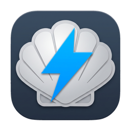
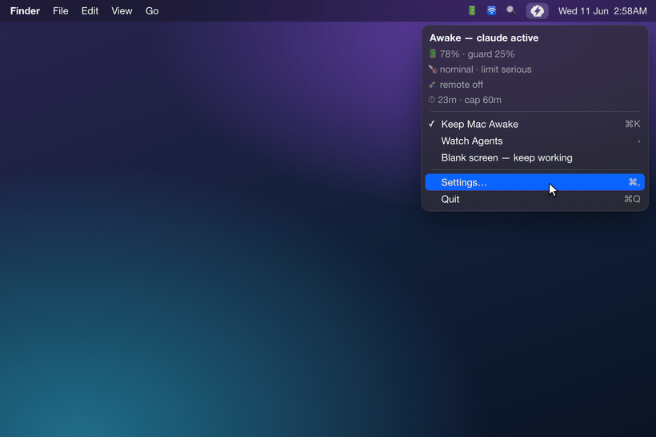
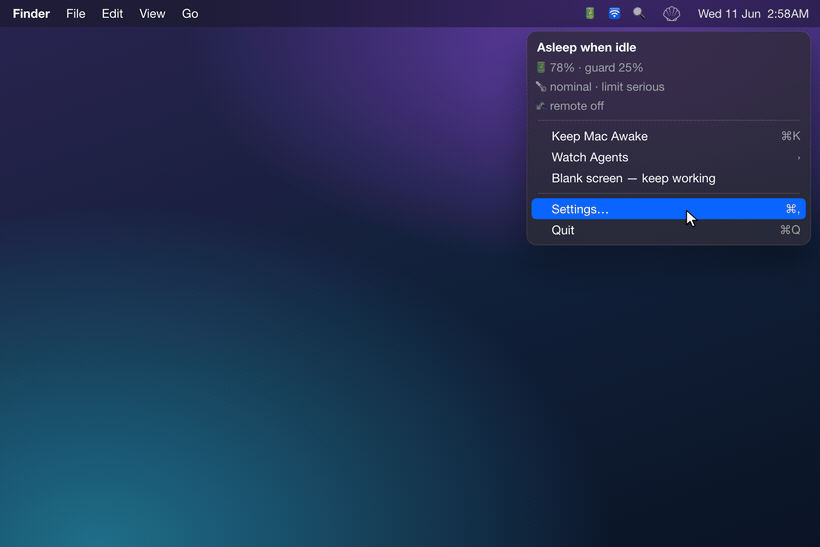
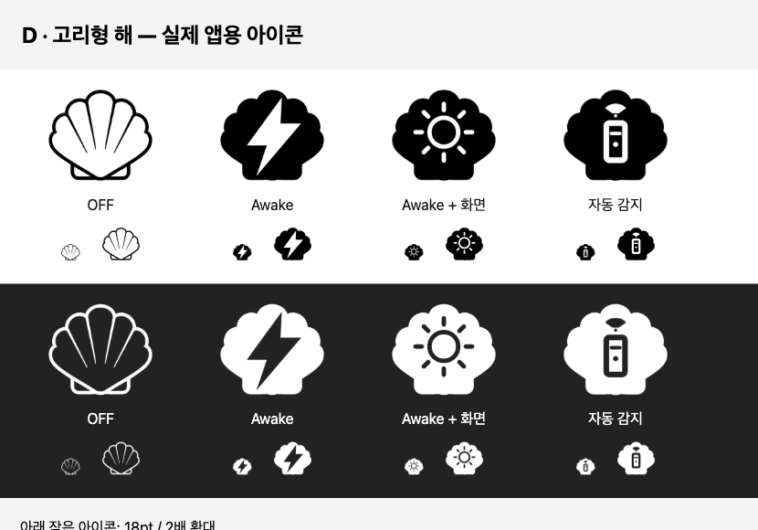

<div align="center">



# Electronic Clam

**Agents must keep working. Your Mac shouldn't cook trying.**
ただ動いているプロセスではなく、*作業*そのものを検知します。

[](https://www.apple.com/macos/)
[](https://swift.org)
[](LICENSE)
[](CHANGELOG.md)

<!-- i18n-langbar -->
[English](README.md) · [한국어](README.ko.md) · [中文](README.zh-CN.md) · **日本語** · [Español](README.es.md)

</div>

---

## v0.8.1の新機能: アプリ内アップデート

- **Sparkleアップデート:** 設定 → 一般 → **アップデートを確認…**から、アプリ内でダウンロード、インストール、再起動できます。インストールはユーザーが選んだときだけ開始します。
- **既存の設定を維持:** 自動確認の設定を引き継ぎます。自動ダウンロードと無人インストールは無効です。
- **更新後のヘルパー更新:** バックグラウンドヘルパーに変更がある場合は再登録して応答を確認します。同じバージョンの再起動では不要な再登録を行いません。
- **0.8.0以前からの移行:** [GitHub Releases](https://github.com/jadhvank/eclam/releases/tag/v0.8.1)またはHomebrewで0.8.1を一度インストールしてください。旧バージョンにはSparkleがないため、その後のリリースからアプリ内更新を利用できます。

```sh
brew update
brew upgrade --cask --greedy jadhvank/tap/eclam
```

---

## v0.8.0 の新機能: メニューバーで画面維持モードを選択

- **クリックで切り替え:** オフ → Macを維持 → Macと画面を維持 → 自動検出。新しい**輪郭の太陽アイコン**で、メニューを開かずに画面維持モードを確認できます。
- **初期設定はオン:** 設定 → 一般 → **アイコンの切り替えに画面維持モードを含める**。オフにすると従来のオン／オフ操作と3種類のアイコンに戻ります。保存済みのオフ設定はアップグレード後も維持します。
- **画面を維持するタイミングを選択:** 設定をオンにするだけではモードが追加されるだけです。**Macと画面を維持**を選ぶと作動します。自動検出は画面維持を要求せず、作業に応じて動作します。安全ガードは引き続き優先されます。

[リリースノート](https://github.com/jadhvank/eclam/releases/tag/v0.8.0) · [全変更履歴](CHANGELOG.md)

---

## ハイライト

- **フタを閉じても起きたまま。** Mac維持モードで、フタを閉じても Mac がスリープしません, ターミナルコマンドも、トグルのたびのパスワードも要りません。
- **プロセスではなく作業を検知。** 自動検出モードでは、コーディングエージェントが*実際に出力を出している間だけ*起きていて、エージェントが止まれば Mac はまたスリープできます。
- **標準で 5 つのエージェントに対応**: Claude Code、Codex、Cursor、opencode、Antigravity, さらに好きなエージェントを自分で追加できます。
- **状況に合わせて動く安全ガード。** バッテリーや温度が危険ラインを越えると自動でスリープします。
- **リモート作業も察知。** 自動検出は SSH・画面共有・Tailscale の活動を認識し、安全ガードの範囲内でリモート作業を維持します。
- **会話やコードは決して読みません。** エージェント検知は transcript のタイムスタンプだけを見て、中身は読みません。

---

## 機能

目標は、エージェントを**安全に**、止めずに働かせ続けること。以下の機能はすべてそのためにあります。デモ動画は以前のメニューを示しています。現在の操作は [Usage](#usage) を参照してください。

### エージェントが働く間だけ起こしておく


シンプルです, エージェントを止めずに働かせ続けること。

自動検出モードは、プロセスが存在するかではなく、エージェントが*いま働いているか*を見ます。働いている間は Mac を起こしておき、止まれば保持を解除します(**Strict** モード)。プロセスが生きている限り起こしておくだけの **Lax** モードもあります。

**標準で検知(5 つ):** Claude Code · Codex · Cursor · opencode · Antigravity。

**Customize で有効化(デフォルトはオフ):** Aider · Cline · Roo Code · OpenHands · Hermes · Openclaw。

ここに載っていないエージェントも追加できます, glob パターンを指定するか、`~/.config/eclam/traces.d/*.json` に宣言ファイルを 1 つ置くだけです。

デフォルトでは、エージェントはセッションログのポーリングで検知します(~5 秒、画面ロック中は ~30 秒)。そのため起動直後のエージェントは現れるまで数秒かかることがあります。Claude・Codex・Hermes は(任意の)hook を入れれば即座に検知できます。

### 安全ガード



クラムシェルモードでバッグに入れたまま重いワークロードを走らせるのは発熱リスクです。Electronic Clam は温度とバッテリーを見ていて、危険になったら Mac をスリープさせます:

- **バッテリー**: しきい値は構成によって変わります:フタを閉じて外部ディスプレイなしなら 30%、それ以外は 10%(調整可)。弱い/不安定な AC 接続はバッテリー扱いです。
- **発熱**: macOS の信号に、より敏感な内部信号を組み合わせて素早く反応します。
- **最大継続時間**: Desktop モード(AC + フタ開き + 外部ディスプレイ)では上限を完全にスキップします。
- **低電力モード**: 両方の基準を 1 段ずつ厳しくします(バッテリー +10 ポイント、発熱 1 段)。

AC を抜いてフタを閉じてバッグに入れた状態では、より慎重に判断し、安全に戻れば自動で解除します。Mac をスリープさせるときに通知を受け取ることもできます。

### リモート活動の検知



自動検出モードでは、安全ガードの範囲内でリモート使用中の Mac を維持します。SSH・画面共有・Tailscale・既知のリモート操作 App を検知します。デフォルトはシンプルで、つながっている間は起きたままです。

### チャット通知: Telegram と Slack（初期設定はオフ）

自分の Telegram ボットや Slack アプリを接続すると、エージェントが停止したり Mac がスリープしたりしたときに、バッテリー残量・温度・ホスト名付きの通知を受け取れます。

どちらも**設定 → 通知**にあり、個別に、または両方を有効にできます。メッセージは設定したサービスにのみ送信され、自分で作成・管理するトークンはこの Mac のユーザー専用ファイルに保存されます。Slack では `chat:write` ボット権限が必要です（チャンネル名の検索には `channels:read` も追加）。アプリをワークスペースにインストールし、対象チャンネルに招待してください。Slack は無音配信に対応していないため、定期ステータスも通常のメッセージとして届きます。静かにしたい場合はチャンネルをミュートしてください。

### その他

- **CLI + 名前付きセッション**: ターミナルから直接操作できます([Usage](#usage) 参照)。
- **任意のエージェント hook**: 入れると Claude / Codex / Hermes の設定に活動シグナルの hook を挿入し、外すと元に戻します。
- **終了時のスリープ復元**: 通常終了と SIGTERM で電源維持を解除し、20秒の helper watchdog がクラッシュ時の復旧を支援します。
- **クラムシェル VPN ロックガード(オプトイン)。** 外部ディスプレイなしのバッテリー駆動では、フタを閉じると通常は画面が*ロック*され、FortiClient SSL VPN が切れます(再接続には SAML の再ログインが必要)。目に見えない仮想ディスプレイがセッションをつなぎ留めるので、画面はロックされずトンネルは生き残ります。**画面だけオフ**の動作も **Dim**(暗いが VPN に安全・デフォルト)と **Sleep** に分かれ、VPN 切断の通知も任意で受け取れます。
- **頑健な helper 登録**: 隔離(quarantine)されたダウンロードや一時的(translocated)な場所からはバックグラウンド helper を登録しません(macOS がそこでの起動を拒むため)。代わりに App を Applications へ移すよう案内します。設定 → 一般 では重複コピーやバージョン不一致を表示し、`eclam repair` / **Reinstall Helper** で固まった登録を復旧できます。

## インストール

```bash
brew install --cask jadhvank/tap/eclam
open /Applications/ElectronicClam.app
```

**System Settings → General → Login Items & Extensions** で **Electronic Clam Helper** をオンにしてください。

## Usage

**左クリック**で**オフ → Macを維持 → Macと画面を維持 → 自動検出 → オフ**と切り替わります。**右クリック**または **Control-click** で全メニューが開きます。起動時は自動検出モードです。

| モード | アイコン | 動作 |
|---|---|---|
| **オフ** | 輪郭の貝殻 | 維持要求を停止し、別のモードを選ぶまで自動活動を抑制します。 |
| **Macを維持** | 塗りつぶした貝殻 + 稲妻 | 画面維持を要求せずに Mac を起こしておきます。 |
| **Macと画面を維持** | 塗りつぶした貝殻 + 輪郭の太陽 | Mac と画面を維持します。太陽は画面維持の要求が取得された後に表示されます。 |
| **自動検出** | 塗りつぶした貝殻 + リモコン | エージェントとリモートの設定に従います。活動待ちの間は薄く表示されます。 |



設定 → 一般 → **アイコンの切り替えに画面維持モードを含める**は初期設定でオンです。オフにすると、従来の実際の維持状態に応じたオン／オフ操作と3種類のアイコンに戻ります。Macと画面を維持中にオフにすると、Macを維持に切り替え、画面維持要求だけを解除します。保存済みのオフ設定は維持されます。

**画面維持は自動ロックを遅らせ、画面の電力を消費します。** 手動ロックや Dim は引き続き利用できます。他のアプリ、ロックガード、Dim も画面を維持する場合があります。メニューの **Display held by** 行で実際の画面維持要求を確認できます。すべてのモードに安全ガードが適用され、helper の障害表示は通常のアイコンより優先されます。

### メニュー

| 項目 | 動作 |
|---|---|
| ステータスヘッダー | 現在の状態がひと目で(例:「アイドル時にスリープ」「起動中, 終了するまで」「起動中, リモートセッション」) |
| **Macをスリープさせない**(⌘K) | 維持を直接切り替える従来のオン／オフショートカット |
| **モード** ▸ | 4つのモードを直接選択。画面維持モードの設定がオンのときに表示 |
| **エージェントを監視** ▸ | 検知するエージェントのオン/オフ(動作中は「 • 動作中」表示);一番下に **カスタマイズ…** |
| **画面だけオフ, 作業は継続** | 内蔵画面をロックせずに暗くする（初期設定）、またはディスプレイをスリープさせて作業を維持 |
| **設定…**(⌘,) | 設定を開く |
| **終了**(⌘Q) | 終了(終了前にスリープを復元) |

### CLI

Homebrew cask が `$HOMEBREW_PREFIX/bin/eclam` シンボリックリンクを作成します。

```
eclam on [--for <dur>] [--forever]   # keep awake; default 2h, then the helper auto-releases (no GUI needed, survives reboot)
eclam off
eclam status [--json]                 # also flags a quarantined/outside-Applications app, a failed helper, and duplicate copies
eclam repair                          # recover a wedged/unreachable helper (relaunches the app; guides you to sfltool resetbtm as a last resort)
eclam keep --while <pid>
eclam watch <agent> [--grace s] [--check-interval s] [--max min] [--json]
eclam session start <name> [--message <text>] / stop <name> / list [--json]
eclam debug [agents] [--json]
eclam help
```

**終了コード:** `0` 成功 · `1` 引数エラー · `2` helper 到達不可 · `3` 承認が必要 · `4` ユーザーがキャンセル。

## セキュリティとプライバシー

- ファイルの内容ではなく時刻を読みます。
- テレメトリ、追跡、分析はありません。
- Developer ID リリースでは XPC 呼び出し元を検証します。ad-hoc 開発ビルドでは無効です。
- Developer ID 署名 + Apple 公証。
- トークンはユーザー専用権限でローカルに保存し、設定したサービスにのみ送信します。
- 通常終了時に電源維持を解除し、helper の watchdog がクラッシュからの復旧を支援します。
- 権限経路は `SMAppService` のみです。

詳細は[セキュリティとプライバシー](docs/security.md)を参照してください。

## 注意 / 既知の制限

- **hook がないと検知が数秒遅れることがあります。** hook を入れていないエージェントはセッションログのポーリングで検知します(~5 秒、ロック中は ~30 秒)。Claude / Codex / Hermes は hook を入れれば即座です。
- **CLI だけでは安全ガードがありません。**
- **Applications から実行してください。** Downloads や隔離(quarantine)されたままのコピーから起動すると、macOS がバックグラウンド helper を起動させません, Electronic Clam を Applications フォルダへ移してから開き直してください。
- **VS Code 組み込みのエージェント**(Cline / Roo Code)は独立したプロセスがないため、Lax モードの検知は限定的です。
- **Apple Silicon 専用**、macOS 13+ (Ventura)。

## 技術スタック

- **言語 / UI:** Swift + AppKit(`NSStatusItem`、`LSUIElement` のメニューバー App, Dock なし)。
- **電源制御:** IOKit SPI, `@_silgen_name` バインディング経由の `IOPMSetSystemPowerSetting("SleepDisabled")`。
- **権限分離:** `NSXPCConnection`(mach service)で App と通信する `SMAppService` デーモン。
- **ビルド:** 直接 `swiftc`(SwiftPM なし)、**外部依存なし**。
- **ターゲット:** arm64、macOS 13+ (Ventura)。

## Build from source

```bash
./scripts/build.sh            # app + helper + hook binaries (Developer ID signed)
open build/ElectronicClam.app
```

- 直接 `swiftc` を呼び出し、ターゲットは `arm64-apple-macos13.0`。素早いアドホックなローカルビルドには `ECLAM_SIGN_ID=-` を設定します。
- バンドル構成:`Contents/MacOS/{ElectronicClam, ElectronicClamHelper, eclam-hook}` + `Contents/Library/LaunchDaemons/com.jadhvank.eclam.helper.plist`。
- リリースビルドは Developer ID 署名 + Apple 公証されます(`release.sh` が staple)。

## リリース履歴

最近のリリース, 全履歴は [CHANGELOG.md](CHANGELOG.md) に:

- **0.8.0**: 4モードのアイコン切り替え、輪郭の太陽による画面維持表示、初期設定オン（既存のオフ設定は維持）、モードの直接選択。[リリースノート](https://github.com/jadhvank/eclam/releases/tag/v0.8.0)。
- **0.7.0**: 画面の点灯維持オプション、明るさを復元する自動 Dim、Slack 通知、ローカルインストーラーと Homebrew の削除処理を改善。VPN の監視だけでスリープを妨げる動作も修正しました。[リリースノート](https://github.com/jadhvank/eclam/releases/tag/v0.7.0)。
- **0.6.5**: 修正:クラムシェルロックガードを有効にしたまま **画面ミラーリング** で TV を接続しても正しく動くようになりました。ミラーリングで接続したディスプレイ(ミラーした TV、AirPlay)はガードから見えていませんでした, macOS はミラーセットのメンバーをアクティブディスプレイ一覧から外し、ミラーセット全体を 1 画面として報告するためです。その結果、macOS がミラーセッションを確立している最中に、目に見えないアンカーが再ミラー・再生成を繰り返して割り込んでいました。拡張(並べて表示)接続はもともと影響を受けません。またミラーセットが有効な間はアンカーを作らなくなりました, その状況で作ると回収できない仮想ディスプレイが残り、ログアウトするまでガードが機能しなくなっていました。
- **0.6.4**: クラムシェル VPN ロックガードの修正:VPN 切断通知が実際に届くようになり(通知すべきイベント自身と App Nap によって監視が止まっていました)、App を終了すると目に見えないアンカーも解放され、仮想ディスプレイの名前が明確になり、**Dim** のあとフタを開け直すと明るさが戻ります。さらに、quarantine 属性だけが残っている場合にメニューバーが「Applications へ移動してください」を繰り返すだけの行き止まりを解消し、サーマルカットオフの既定値を `fair` から `serious` に引き上げました(以前の既定値では数分で keep-awake が終了することがありました)。
- **0.6.3**: 修正:クラムシェルロックガードを有効にした状態で実機の外部ディスプレイを接続しても、保存済みの「内蔵 + 外部」の配置が崩れなくなりました。実機ディスプレイが現れると、目に見えないアンカーが即座に道を譲り(再ミラーしない)、macOS が保存した配置を復元します。外部ディスプレイを外すとアンカーは自動的に戻ります。クラムシェル(ヘッドレス)のロック防止そのものは変わりません。
- **0.6.2**: クラムシェル VPN ロックガード(オプトイン):外部ディスプレイなしのバッテリー駆動で、フタを閉じても画面がロックされなくなり、FortiClient SSL VPN が切れずに維持されます, 目に見えない仮想ディスプレイがセッションをつなぎ留めます。**画面だけオフ**の動作は **Dim**(VPN に安全・デフォルト)と **Sleep** から選べ、VPN 切断の通知も任意です。
- **0.6.1**: 正直な helper ステータス:死んでいるのに登録だけ残った helper が、もう誤って「有効」と表示されません。`eclam status` はそれを `unreachable`(終了コード 2)として報告し、App は再起動時に自己修復し、新しい `eclam repair` コマンドとメニューバーの警告がそれを可視化し、`eclam status` は起動時ログイン(Open at Login)の状態も報告するようになりました。
- **0.6.0**: 起動時ログイン、アプリ内更新通知、起動履歴、国際化(English · 한국어 · 中文 · 日本語 · Español)、シングルクリック切り替え、メニューバーアイコンのテーマ、リモートアイドルポリシー、Telegram ステータス通知、Developer ID 署名 + 公証。

それ以前:エージェント検知と `watch` / `session` CLI(0.5.x)、状態条件つきのバッテリー / 発熱 / タイマー安全ガード(0.4.x)、リモート活動の検知と最初の CLI(0.3.x)。

## 支援

Electronic Clam は無料のオープンソースです。エージェントを起こしておくのは Electronic Clam、開発者を起こしておくのはあなたのコーヒー。☕

[](https://ko-fi.com/jadhvank)

## ライセンス

[MIT](LICENSE)。

---

<sub>`README.zh-CN.md`、`README.ja.md`、`README.es.md` は本ファイルから `/translate` コマンドで生成されます, 手動で編集しないでください。`README.ko.md` は手動でメンテナンスします。</sub>
