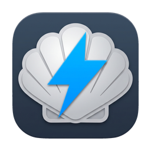
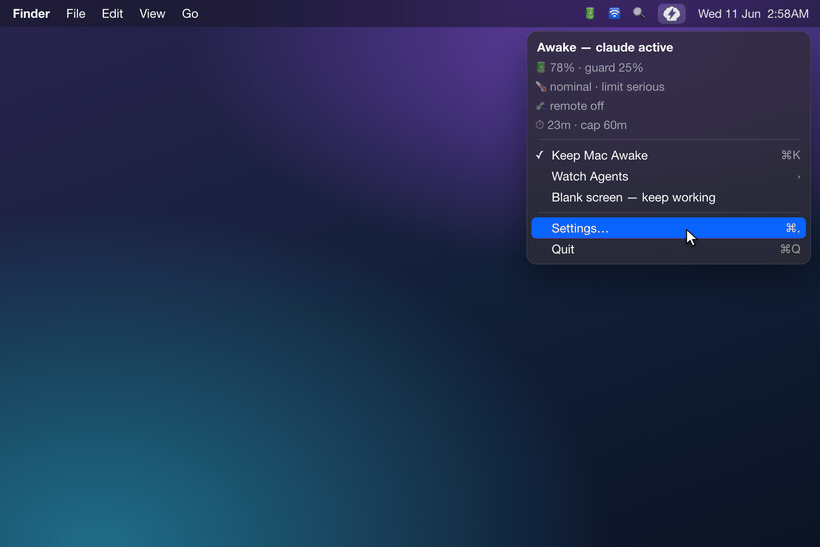
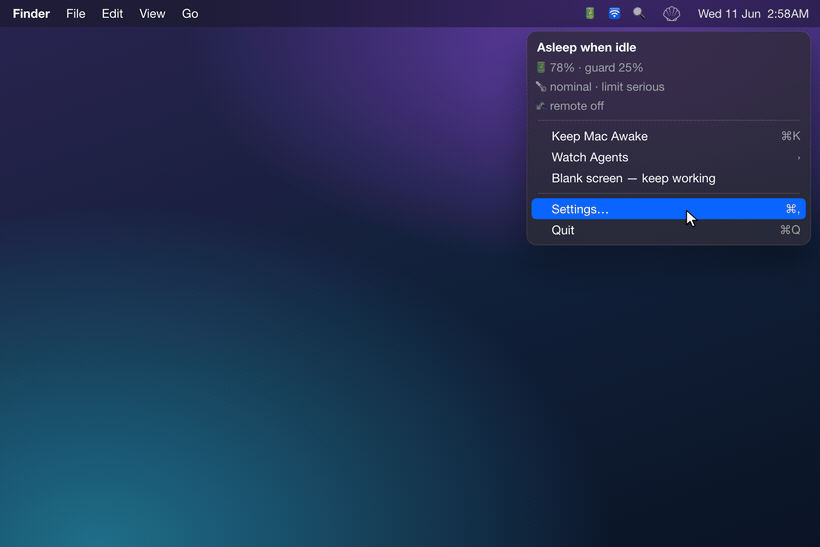
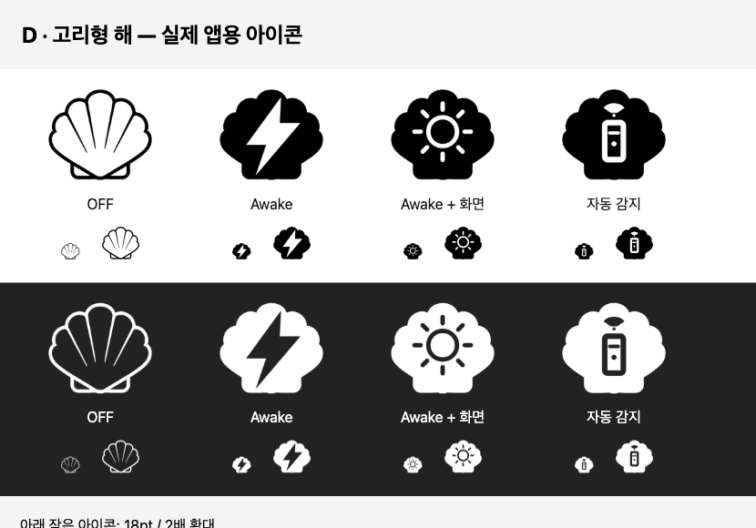

<div align="center">



# Electronic Clam

**Agents must keep working. Your Mac shouldn't cook trying.**
에이전트는 쉬지 않게, Mac은 타지 않게.

[](https://www.apple.com/macos/)
[](https://swift.org)
[](LICENSE)
[](CHANGELOG.md)

<!-- i18n-langbar -->
[English](README.md) · **한국어** · [中文](README.zh-CN.md) · [日本語](README.ja.md) · [Español](README.es.md)

</div>

---

## v0.8.1 업데이트: 앱 안에서 업데이트

- **Sparkle 업데이트:** 설정 → 일반 → **업데이트 확인…**에서 다운로드, 설치, 재실행까지 진행합니다. 설치는 사용자가 선택할 때만 시작합니다.
- **기존 설정 보존:** 자동 확인 설정을 그대로 이전합니다. 자동 다운로드와 무인 설치는 비활성화되어 있습니다.
- **업데이트 후 도우미 갱신:** 변경된 백그라운드 도우미를 다시 등록하고 통신을 확인합니다. 같은 버전을 다시 실행할 때는 불필요하게 재등록하지 않습니다.
- **0.8.0 이하에서 업그레이드:** [GitHub Releases](https://github.com/jadhvank/eclam/releases/tag/v0.8.1) 또는 Homebrew로 0.8.1을 한 번 설치하세요. 이전 버전에는 Sparkle이 없으며, 이후 릴리스부터 앱 안에서 업데이트할 수 있습니다.

```sh
brew update
brew upgrade --cask --greedy jadhvank/tap/eclam
```

---

## v0.8.0 업데이트: 메뉴바에서 화면 유지까지

- **아이콘을 클릭하면 네 모드가 순환합니다:** 끄기 → Mac 유지 → Mac + 화면 유지 → 자동 감지. 새 **고리형 해 아이콘**으로 화면 유지가 작동 중인지 바로 확인할 수 있습니다.
- **기본값은 켜짐입니다:** 설정 → 일반 → **아이콘 순환에 화면 켜짐 유지 모드 포함**. 끄면 기존 켜기/끄기 클릭과 세 가지 아이콘으로 돌아갑니다. 이미 꺼 두었던 설정은 업데이트해도 유지합니다.
- **화면 유지는 직접 선택할 때만 시작합니다:** 설정을 켜면 모드가 추가되고, **Mac + 화면 유지**를 선택해야 화면을 계속 켜 둡니다. 자동 감지에서는 작업에 맞춰 Mac만 유지하며, 안전 가드는 모든 모드보다 우선합니다.

[릴리스 노트](https://github.com/jadhvank/eclam/releases/tag/v0.8.0) · [전체 변경 내역](CHANGELOG.md)

---

## 핵심 기능

- **덮개를 닫아도 깨어있게.** Mac 유지 모드에서는 덮개를 닫아도 Mac이 잠들지 않습니다. 터미널 명령도, 토글할 때마다 비밀번호를 넣을 일도 없습니다.
- **프로세스가 아니라 작업을 감지합니다.** 자동 감지 모드에서는 코딩 에이전트가 *실제로 결과를 뽑아내는 동안에만* 깨어있고, 작업이 끝나 에이전트가 멈추면 Mac도 다시 잠들 수 있습니다.
- **기본 5종 에이전트 인식**: Claude Code, Codex, Cursor, opencode, Antigravity. 원하는 에이전트는 직접 추가할 수 있습니다.
- **상황에 맞춰 움직이는 안전 가드.** 배터리나 온도가 위험선을 넘으면 알아서 잠듭니다.
- **원격 작업도 알아챕니다.** 자동 감지 모드에서 SSH·화면 공유·Tailscale 활동을 인식해 원격 작업을 유지합니다. 안전 가드는 원격 작업 중에도 적용됩니다.
- **대화나 코드는 절대 들여다보지 않습니다.** 에이전트 감지는 transcript 파일의 수정 시간만 확인할 뿐입니다.

---

## 기능

목표는 에이전트가 **안전하게**, 멈추지 않고 일하게 두는 것. 아래 기능은 모두 그걸 위한 장치입니다. 데모 영상은 이전 메뉴 기준이며, 현재 조작 방법은 [Usage](#usage)를 참고하세요.

### 에이전트가 일하는 동안 Mac은 깨워두기


핵심은 에이전트가 멈추지 않고 일하게 두는 것입니다.

자동 감지 모드는 프로세스가 떠 있는지가 아니라, 에이전트가 *지금 일하는지*를 봅니다. 일하는 동안엔 Mac을 깨워두고, 멈추면 바로 풀립니다 (**Strict**). 프로세스가 살아있는 한 계속 깨워두는 **Lax** 모드도 있습니다.

**기본 인식 (5종):** Claude Code · Codex · Cursor · opencode · Antigravity.

**Customize에서 켜기 (기본 꺼짐):** Aider · Cline · Roo Code · OpenHands · Hermes · Openclaw.

여기 없는 에이전트도 직접 넣을 수 있습니다. glob 패턴을 추가하거나, `~/.config/eclam/traces.d/*.json`에 선언 파일 하나만 두면 됩니다.

감지는 기본적으로 세션 로그를 폴링합니다 (~5초, 화면 잠금 시 ~30초). 그래서 방금 띄운 에이전트는 몇 초 늦게 잡힐 수 있습니다. Claude · Codex · Hermes는 hook을 설치하면 이 지연 없이 바로 잡힙니다 (선택).

### 위험할 땐 알아서 잠들기



클램쉘 모드로 가방에 넣고 무거운 작업을 돌리면 발열이 위험할 수 있습니다. Electronic Clam은 온도와 배터리를 지켜보다가, 위험해지면 깨우는 걸 멈추고 Mac을 sleep 모드로 보냅니다:

- **배터리**: 상황에 따라 기준이 다릅니다. 외장 화면 없이 덮개를 닫으면 30%, 아니면 10% (조정 가능). AC 연결이 약하거나 불안정하면 배터리로 봅니다.
- **발열**: macOS 신호에 더 민감한 내부 신호를 더해 빨리 반응합니다.
- **최대 지속 시간**: Desktop 모드(AC + 덮개 열림 + 외장 화면)에선 시간 제한을 건너뜁니다.
- **저전력 모드**: 위 두 기준을 한 단계씩 더 빡빡하게 잡습니다 (배터리 +10%p, 발열 한 단계).

AC가 빠지고 덮개까지 닫혀 가방에 들어간 상태라면 더 깐깐하게 판단합니다. 다시 안전해지면 자동으로 풀립니다. 자동으로 sleep 모드로 들어갈 때 알림을 받을 수 있습니다.

### 원격 활동 인지



자동 감지 모드에서는 다른 기기에서 접속해 쓰는 동안 Mac을 유지합니다. 안전 가드가 작동하면 유지 요청을 해제합니다. SSH, 화면 공유, Tailscale, 알려진 원격 제어 앱을 감지합니다. 기본값은 "접속해 있는 한 깨어있기"입니다.

### Telegram·Slack 알림 (기본 꺼짐)

직접 만든 Telegram 봇이나 Slack 앱을 연결하면 에이전트가 멈추거나 Mac의 깨어있기 유지가 끝날 때 배터리·온도·호스트 이름을 담은 알림을 받을 수 있습니다.

설정 → 알림에서 각각 켜며, 둘을 함께 사용할 수도 있습니다. 메시지는 직접 설정한 서비스와 채팅·채널로만 전송됩니다. 토큰은 이 Mac의 사용자 전용 파일에 저장합니다. Slack 봇에는 `chat:write` 권한이 필요하고, 채널 이름을 조회하려면 `channels:read`도 추가하세요. 앱을 워크스페이스에 설치하고 해당 채널에 초대해야 합니다. Slack은 무음 전송을 지원하지 않아 정기 상태 알림도 일반 메시지로 도착합니다.

### 그 외

- **CLI + 이름 붙인 세션**: 터미널에서 바로 다룰 수 있습니다 ([Usage](#usage)).
- **에이전트 hook 설치 (선택)**: 설치하면 Claude / Codex / Hermes 설정에 hook이 삽입되고, 삭제 시 복원됩니다.
- **종료할 때 잠자기 방지 해제**: 정상 종료와 SIGTERM에서 유지 요청을 해제하고, 크래시 때는 도우미의 20초 watchdog이 복구를 맡습니다.
- **클램쉘 VPN 잠금 방지 (선택).** 외장 화면 없이 배터리로 쓸 때 덮개를 닫으면 보통 화면이 *잠기는데*, 이때 FortiClient SSL VPN이 끊깁니다(다시 연결하려면 SAML 재로그인이 필요합니다). 보이지 않는 가상 디스플레이가 세션을 붙잡아 둬서 화면이 잠기지 않고 터널도 살아있습니다. **화면만 끄기** 동작도 **Dim**(어둡지만 VPN은 안전, 기본)과 **Sleep**으로 나뉘고, VPN이 끊기면 알림을 받을 수도 있습니다.
- **견고한 도우미 등록**: 검역된 다운로드본이나 임시(translocated) 위치에서는 macOS가 백그라운드 도우미 실행을 막으므로, 그런 곳에선 등록하지 않고 Applications로 옮기라고 안내합니다. 설정 → 일반에서 중복 복사본·버전 불일치를 표시하며, `eclam repair` / **Reinstall Helper**로 꼬인 등록을 복구합니다.

## 설치

```bash
brew install --cask jadhvank/tap/eclam
open /Applications/ElectronicClam.app
```

**System Settings → General → Login Items & Extensions**에서 **Electronic Clam Helper**를 On 하세요.

## Usage

메뉴바 아이콘을 **좌클릭**하면 **끄기 → Mac 유지 → Mac + 화면 유지 → 자동 감지 → 끄기** 순으로 바뀝니다. **우클릭**이나 **Control-click**은 전체 메뉴를 엽니다. 앱은 자동 감지 모드로 시작합니다.

| 모드 | 아이콘 | 동작 |
|---|---|---|
| **끄기** | 윤곽선 조개 | 유지 요청을 해제합니다. 다른 모드를 선택하기 전까지 자동 활동이 감지돼도 다시 켜지지 않습니다. |
| **Mac 유지** | 채워진 조개 + 번개 | 화면 유지 요청 없이 Mac을 계속 깨워 둡니다. |
| **Mac + 화면 유지** | 채워진 조개 + 고리형 해 | Mac과 화면을 함께 유지합니다. 해 아이콘은 화면 유지 요청이 실제로 적용된 뒤 표시됩니다. |
| **자동 감지** | 채워진 조개 + 리모컨 | 기존 에이전트·원격 설정에 따라 동작합니다. 활동 대기 중에는 아이콘이 흐리게 표시됩니다. |



설정 → 일반 → **아이콘 순환에 화면 켜짐 유지 모드 포함**은 기본 ON입니다. 끄면 기존 켜기/끄기 클릭과 세 가지 아이콘으로 돌아갑니다. Mac + 화면 유지 중 이 설정을 끄면 Mac 유지로 전환하고 화면 유지 요청만 해제합니다. 이전에 저장한 OFF 설정은 보존합니다.

**화면 유지는 자동 잠금을 늦추고 화면 전력을 사용합니다.** 수동 잠금과 어둡게(Dim)는 계속 사용할 수 있습니다. 다른 앱·잠금 방지·Dim도 화면을 유지할 수 있으며, 메뉴의 화면 유지 앱 표시에서 실제 요청을 확인할 수 있습니다. 안전 가드와 도우미 미응답 표시는 일반 모드 표시보다 우선합니다.

### 메뉴

| 항목 | 동작 |
|---|---|
| 상태 헤더 | 지금 상태를 한눈에 (예: "유휴 시 잠자기", "깨어있음: 종료할 때까지", "깨어있음: 원격 세션") |
| **Mac 깨어있게 유지** (⌘K) | 기존처럼 유지 요청을 바로 켜고 끄기 |
| **모드** ▸ | 네 모드 중 직접 선택, 화면 유지 모드 설정을 켰을 때 표시 |
| **에이전트 감시** ▸ | 감지할 에이전트 켜고 끄기 (활동 중이면 "• 활동 중") · 맨 아래 **사용자화…** |
| **화면만 끄기: 작업은 계속** | 기본은 잠그지 않고 내장 화면을 어둡게(Dim). 설정에서 디스플레이 잠자기(Sleep)로 변경 가능 |
| **설정…** (⌘,) | 설정 열기 |
| **종료** (⌘Q) | 종료 (종료 전 sleep 복원) |

### CLI

Homebrew cask가 `$HOMEBREW_PREFIX/bin/eclam` 심볼릭 링크를 만듭니다.

```
eclam on [--for <dur>] [--forever]   # keep awake; default 2h, then the helper auto-releases (no GUI needed, survives reboot)
eclam off
eclam status [--json]                 # 검역됨/Applications 밖 앱, 도우미 시작 실패, 중복 복사본도 함께 표시
eclam repair                          # 꼬이거나 응답 없는 도우미 복구 (앱 재기동; 최후수단으로 sfltool resetbtm 안내)
eclam keep --while <pid>
eclam watch <agent> [--grace s] [--check-interval s] [--max min] [--json]
eclam session start <name> [--message <text>] / stop <name> / list [--json]
eclam debug [agents] [--json]
eclam help
```

**Exit code:** `0` 성공 · `1` 잘못된 인자 · `2` helper 도달 불가 · `3` 승인 필요 · `4` 사용자 취소.

## 보안 및 프라이버시

- 파일 내용이 아니라 수정 시각만 읽습니다.
- 추적도 분석도 텔레메트리도 없습니다.
- Developer ID 릴리스는 XPC 호출자 서명을 검증합니다. ad-hoc 개발 빌드에서는 비활성화됩니다.
- Developer ID 서명 + Apple 노터라이즈.
- 토큰은 로컬의 사용자 전용 파일에 저장하며, 설정한 서비스에만 전송합니다.
- 정상 종료 시 유지 요청을 해제하고, 도우미 watchdog으로 크래시 복구를 지원합니다.
- 권한은 SMAppService 한 길뿐입니다.

자세한 내용은 [보안 문서](docs/security.md)를 참고하세요.

## 주의사항 / 알려진 제약

- **hook 없으면 감지에 몇 초 지연이 있을 수 있습니다.** hook을 설치하지 않은 에이전트는 세션 로그 폴링으로 잡습니다(~5초, 잠금 시 ~30초). Claude · Codex · Hermes는 hook을 설치하면 즉시 잡힙니다.
- **CLI만 쓰면 안전 가드가 없습니다.**
- **Applications에서 실행하세요.** Downloads나 아직 검역된 복사본에서 열면 macOS가 백그라운드 도우미를 실행하지 못합니다, Electronic Clam을 Applications 폴더로 옮긴 뒤 다시 열어 주세요.
- **VS Code 안에서 도는 에이전트**(Cline · Roo Code)는 독립 프로세스가 없어 Lax 모드 감지가 제한적입니다.
- **Apple Silicon 전용**, macOS 13+ (Ventura).

## 기술 스택

- **언어 / UI:** Swift + AppKit (`NSStatusItem`, `LSUIElement` 메뉴바 앱, Dock 없음).
- **전원 제어:** IOKit SPI, `@_silgen_name` 바인딩을 통한 `IOPMSetSystemPowerSetting("SleepDisabled")`.
- **권한 분리:** `NSXPCConnection`(mach service)으로 앱과 통신하는 `SMAppService` 데몬.
- **빌드:** 직접 `swiftc` (SwiftPM 없음), **외부 의존성 없음**.
- **타깃:** arm64, macOS 13+ (Ventura).

## Build from source

```bash
./scripts/build.sh            # app + helper + hook binaries (Developer ID signed)
open build/ElectronicClam.app
```

- 직접 `swiftc` 호출, `arm64-apple-macos13.0` 타깃. 빠른 ad-hoc 로컬 빌드는 `ECLAM_SIGN_ID=-`로 설정하세요.
- 번들 레이아웃: `Contents/MacOS/{ElectronicClam, ElectronicClamHelper, eclam-hook}` + `Contents/Library/LaunchDaemons/com.jadhvank.eclam.helper.plist`.
- 릴리스 빌드는 Developer ID 서명 + 노터라이즈됩니다 (`release.sh`가 staple).

## 릴리스 내역

최근 릴리스. 전체 내역은 [CHANGELOG.md](CHANGELOG.md):

- **0.8.0**: 네 모드 클릭 순환과 고리형 해 아이콘, 화면 유지 모드 기본 ON, 기존 OFF 설정 보존, 메뉴에서 모드 직접 선택. [릴리스 노트](https://github.com/jadhvank/eclam/releases/tag/v0.8.0).
- **0.7.0**: 화면 계속 켜두기 옵션, 밝기 복원을 갖춘 자동 어둡게, Slack 알림, 설치 복구와 Homebrew 삭제 절차 개선. VPN 감시만으로 잠자기를 막던 동작도 수정했습니다. [릴리스 노트](https://github.com/jadhvank/eclam/releases/tag/v0.7.0).
- **0.6.5**: 수정. 클램쉘 잠금 방지를 켠 상태에서 **화면 미러링**으로 TV 를 연결해도 정상 동작합니다. 미러링으로 붙인 화면(미러링한 TV, AirPlay)은 잠금 가드에 보이지 않았습니다. macOS 는 미러셋 멤버를 활성 디스플레이 목록에서 빼고 미러셋 전체를 화면 하나로 보고하기 때문입니다. 그래서 macOS 가 미러 세션을 맺는 동안 보이지 않는 앵커가 계속 재미러·재생성되며 끼어들었습니다. 확장(나란히 놓기) 연결은 원래부터 영향이 없었습니다. 또한 미러셋이 켜져 있는 동안에는 앵커를 만들지 않습니다. 그 경우 회수되지 않는 가상 디스플레이가 남아 로그아웃 전까지 잠금 방지가 아예 동작하지 않았습니다.
- **0.6.4**: 클램쉘 VPN 잠금 방지 수정. VPN 끊김 알림이 실제로 뜨고(자기가 알려야 할 바로 그 사건과 App Nap 에 감시가 멈추던 문제), 앱을 종료하면 보이지 않는 앵커가 함께 사라지며, 가상 디스플레이 이름이 명확해지고, **Dim** 후 덮개를 다시 열면 밝기가 복원됩니다. 그리고 quarantine 속성만 남은 경우 메뉴바가 "Applications 로 옮기세요" 안내만 반복하던 막다른 길을 없앴고, 열 컷오프 기본값을 `fair` 에서 `serious` 로 올렸습니다(기존 기본값은 몇 분 만에 keep-awake 를 끝낼 수 있었습니다).
- **0.6.3**: 수정. 클램쉘 잠금 방지를 켠 상태에서 실물 외장 모니터를 연결해도 더 이상 저장해 둔 내장+외장 화면 배치가 흐트러지지 않습니다. 보이지 않는 앵커가 실물 화면이 나타나면 재미러 없이 즉시 비켜서, macOS가 저장된 배치를 그대로 복원합니다(외장을 빼면 앵커가 자동 복귀). 덮개 닫은 클램쉘 잠금 방지 동작 자체는 그대로입니다.
- **0.6.2**: 클램쉘 VPN 잠금 방지 (선택). 외장 화면 없이 배터리로 쓸 때 덮개를 닫아도 더 이상 화면이 잠기지 않아, FortiClient SSL VPN이 끊기지 않고 유지됩니다, 보이지 않는 가상 디스플레이가 세션을 붙잡아 둡니다. "화면만 끄기" 동작은 이제 **Dim**(VPN 안전, 기본)과 **Sleep** 중에서 고를 수 있고, VPN 끊김 알림도 선택할 수 있습니다.
- **0.6.1**: 정직한 helper 상태. 죽었는데 등록만 살아있는 helper가 더 이상 거짓 "enabled"로 보고되지 않습니다. `eclam status`가 `unreachable`(exit 2)로 보고하고, 앱이 재실행 시 자가복구하며, 새 `eclam repair` 명령과 메뉴바 경고가 이를 드러냅니다. `eclam status`는 "로그인 시 실행" 상태도 함께 보고합니다.
- **0.6.0**: 로그인 시 실행, 알림형 인앱 업데이트, awake 히스토리, 다국어(English · 한국어 · 中文 · 日本語 · Español), 단일 클릭 토글, 메뉴바 아이콘 테마, 원격 유휴 정책, Telegram 상태 알림, Developer ID 서명 + 노터라이즈.

이전: 에이전트 인지 감지 및 `watch` / `session` CLI (0.5.x), 상태조건 배터리 / 발열 / 타이머 안전 가드 (0.4.x), 원격 활동 인지 및 첫 CLI (0.3.x).

## 후원

Electronic Clam은 무료 오픈 소스입니다. 에이전트는 Electronic Clam이 깨워두고, 개발자는 여러분의 커피가 깨워두고. ☕

[](https://ko-fi.com/jadhvank)

## 라이선스

[MIT](LICENSE).
