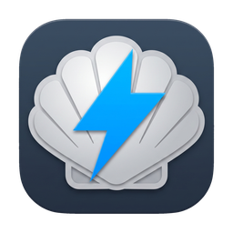
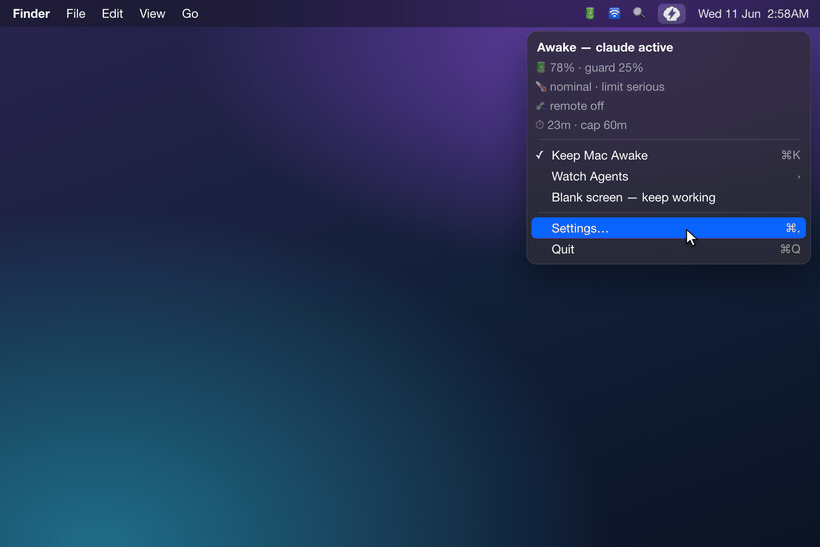
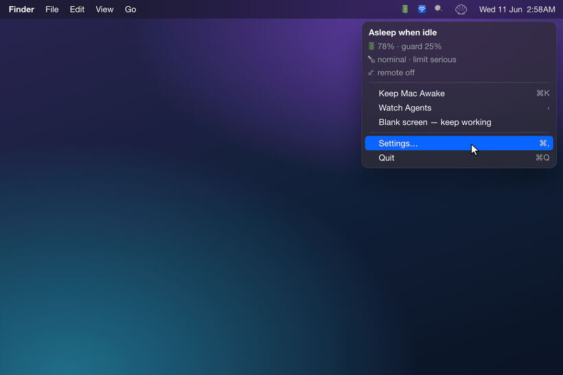
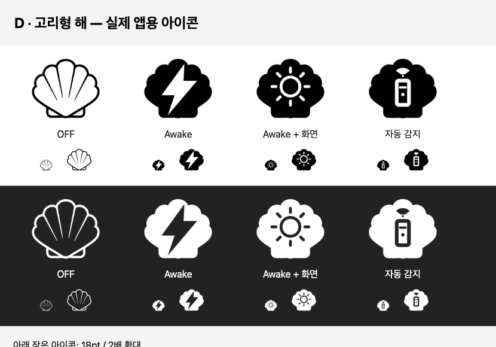

<div align="center">



# Electronic Clam

**Agents must keep working. Your Mac shouldn't cook trying.**
It detects *work*, not just a running process.

[](https://www.apple.com/macos/)
[](https://swift.org)
[](LICENSE)
[](CHANGELOG.md)

<!-- i18n-langbar -->
**English** · [한국어](README.ko.md) · [中文](README.zh-CN.md) · [日本語](README.ja.md) · [Español](README.es.md)

</div>

---

## New in v0.8.2: safer sleep recovery

Sleep restoration retries after failures, and choosing Off cancels active holds together. Safety monitoring stops extending awake time if its checks become stale. Agent detection now rejects future timestamps and prioritizes active Claude workspaces. Update from v0.8.1 in Settings.

## New in v0.8.1: in-app updates

- **Sparkle updates:** Settings → General → **Check for Updates…** now offers download, installation and relaunch inside the app. Installation starts only when you choose it.
- **Existing preferences are preserved:** your automatic-check setting is carried over. Automatic downloads and unattended installation are disabled.
- **Helper refresh after an upgrade:** the app refreshes a changed background helper and verifies it is reachable, avoiding unnecessary re-registration on subsequent launches.
- **Upgrading from 0.8.0 or earlier:** install 0.8.1 once from [GitHub Releases](https://github.com/jadhvank/eclam/releases/tag/v0.8.1) or Homebrew. Those older versions cannot use Sparkle; subsequent releases can update in-app.

```sh
brew update
brew upgrade --cask --greedy jadhvank/tap/eclam
```

---

## New in v0.8.0: screen-on mode in the menu bar

- **Click to cycle:** Off → Awake → Awake + screen → Auto detection. The new **ring-sun icon** identifies screen-on mode without opening a menu.
- **Enabled by default:** Settings → General → **Include screen-on mode in the icon cycle**. Turn it off to keep the original on/off click and three icons. An explicitly saved OFF preference stays off after upgrading.
- **Choose when to keep the screen on:** enabling the setting only adds the mode. Select **Awake + screen** to activate it; Auto detects work without requesting screen-on protection. Safety guards still take priority.

[Release notes](https://github.com/jadhvank/eclam/releases/tag/v0.8.0) · [Full changelog](CHANGELOG.md)

---

## Highlights

- **Lid-closed keep-awake.** Awake mode stops your Mac from sleeping even with the lid shut, without terminal commands or a password per toggle.
- **Detects work, not processes.** Auto mode stays awake only while a coding agent is *actively producing output*; once the agent stops, your Mac can sleep again.
- **5 agents out of the box**: Claude Code, Codex, Cursor, opencode, Antigravity, plus any others you add yourself.
- **Safety guards that adapt.** Auto-sleeps when battery or temperature crosses a danger line.
- **Remote-activity aware.** Auto mode recognizes SSH, screen sharing, and Tailscale activity to keep remote work running, subject to safety guards.
- **Never reads your conversations or code.** Agent detection only looks at transcript timestamps, never their contents.

---

## Features

The goal is to keep your agent working **safely**, without interruption. Everything below serves that. Demo clips show earlier menu layouts; the current controls are described in [Usage](#usage).

### Agent-aware keep-awake


The point is simple: let your agent keep working, uninterrupted.

Auto mode tracks whether the agent is *working right now*, not whether a process exists. While it works, the Mac stays awake; when it stops, the hold releases (**Strict** mode). A **Lax** mode that simply stays awake while the process is alive is also available.

**Detected by default (5):** Claude Code · Codex · Cursor · opencode · Antigravity.

**Opt-in via Customize (off by default):** Aider · Cline · Roo Code · OpenHands · Hermes · Openclaw.

To add other agents, give a glob pattern or drop a single declaration file into `~/.config/eclam/traces.d/*.json`.

By default agents are detected by polling their session logs (~5 s, ~30 s while the screen is locked), so a just-started agent can take a few seconds to appear. Claude, Codex, and Hermes can be detected instantly by installing their (optional) hooks.

### Safety guards



Running a heavy workload in clamshell mode inside a bag is a thermal risk. Electronic Clam watches temperature and battery, and lets the Mac sleep when things get risky:

- **Battery**: the threshold depends on your setup: 30% with the lid closed and no external display, 10% otherwise (adjustable). A weak or unstable AC connection counts as battery.
- **Thermal**: combines the macOS signal with a more sensitive internal one to react faster.
- **Max duration**: Desktop mode (AC + lid open + external display) skips the cap entirely.
- **Low Power Mode**: tightens both by one step (+10pp battery, one thermal notch).

With AC unplugged and the lid closed in a bag it judges more conservatively, then clears automatically once things are safe again. You can opt into a notification when it puts the Mac to sleep.

### Remote-activity awareness



In Auto mode, Electronic Clam keeps the Mac awake while you use it remotely, subject to safety guards. It detects SSH, screen sharing, Tailscale, and known remote-control apps. The default is simple: stay awake as long as you're connected.

### Chat notifications: Telegram and Slack (off by default)

Connect your own Telegram bot or your own Slack app and you'll get a ping when an agent stops or your Mac goes to sleep, with battery %, temperature, and host name attached.

Both backends live in **Settings → Notifications** and are independent: enable either one, or both. Messages go only to the service you configured, using a token you create and own; the token stays on this Mac in a user-only file. For Slack you need an app with the `chat:write` bot scope (add `channels:read` to look up a channel by name), installed to your workspace and invited to the channel. Slack has no silent delivery, so the periodic status message arrives like any other. Mute the channel if you want it quiet.

### Other

- **CLI + named sessions**: drive it straight from the terminal (see [Usage](#usage)).
- **Optional agent hooks**: installing injects an activity-signal hook into Claude / Codex / Hermes configs; uninstalling restores them.
- **Sleep restoration on exit**: normal quit and SIGTERM release power holds, with a 20-second helper watchdog for crash recovery.
- **Clamshell VPN lock guard (opt-in).** With no external display on battery, closing the lid normally *locks* the screen, which drops a FortiClient SSL VPN (it needs a SAML re-login to reconnect). An invisible virtual display anchors the session so the screen doesn't lock and the tunnel survives. The **Blank screen** action also splits into **Dim** (dark but VPN-safe, default) vs **Sleep**, with an optional VPN-disconnect notification.
- **Resilient helper setup**: won't register the background helper from a quarantined download or a temporary (translocated) location, where macOS blocks it; it guides you to move the app to Applications instead. Settings → General flags duplicate copies and version mismatches, and `eclam repair` / **Reinstall Helper** recover a wedged registration.

## Install

```bash
brew install --cask jadhvank/tap/eclam
open /Applications/ElectronicClam.app
```

Turn on **Electronic Clam Helper** in **System Settings → General → Login Items & Extensions**.

## Usage

**Left-click** cycles **Off → Awake → Awake + screen → Auto detection → Off**. **Right-click** or **Control-click** opens the full menu. The app starts in Auto detection.

| Mode | Icon | Behavior |
|---|---|---|
| **Off** | Outline shell | Stops the app's keep-awake request and suppresses automatic activity until you choose another mode. |
| **Awake** | Filled shell + lightning | Keeps the Mac awake without requesting display protection. |
| **Awake + screen** | Filled shell + ring sun | Keeps the Mac and screen awake. The sun appears after screen protection is acquired. |
| **Auto detection** | Filled shell + remote | Follows your agent and remote settings. The icon is dimmed while waiting for activity. |



Settings → General → **Include screen-on mode in the icon cycle** is ON by default. Turning it OFF restores the original effective-awake on/off click and three-state icon. If you turn it off while using Awake + screen, the app switches to Awake and releases its screen-on request. Existing saved OFF preferences are preserved.

**Screen protection can delay automatic locking and uses display power.** You can still lock manually or use Dim. Other apps, lock guard, or Dim may also hold the screen awake; the menu's **Display held by** line shows actual display assertions. All modes remain subject to the safety guards, and a helper failure takes precedence over the normal icon.

### Menu

| Item | Action |
|---|---|
| Status header | Current state at a glance (e.g., "Asleep when idle", "Awake: until I quit", "Awake: remote session") |
| **Keep Mac Awake** (⌘K) | Toggle keep-awake directly; this remains an on/off shortcut |
| **Mode** ▸ | Select one of the four modes directly; shown when screen-on mode is enabled |
| **Watch Agents** ▸ | Enable/disable the agents to detect (shows " • active" when one is); **Customize…** at the bottom |
| **Blank screen: keep working** | Dim the built-in screen without locking (default), or sleep the displays; keep work running |
| **Settings…** (⌘,) | Open settings |
| **Quit** (⌘Q) | Quit (restores sleep first) |

### CLI

The Homebrew cask creates a `$HOMEBREW_PREFIX/bin/eclam` symlink.

```
eclam on [--for <dur>] [--forever]   # keep awake; default 2h, then the helper auto-releases (no GUI needed, survives reboot)
eclam off
eclam status [--json]                 # also flags a quarantined/outside-Applications app, a failed helper, and duplicate copies
eclam repair                          # recover a wedged/unreachable helper (relaunches the app; guides you to sfltool resetbtm as a last resort)
eclam keep --while <pid>
eclam watch <agent> [--grace s] [--check-interval s] [--max min] [--json]
eclam session start <name> [--message <text>] / stop <name> / list [--json]
eclam debug [agents] [--json]
eclam help
```

**Exit codes:** `0` success · `1` bad arguments · `2` helper unreachable · `3` approval required · `4` user cancelled.

## Security & privacy

- Reads file clocks, not file contents.
- No telemetry, no tracking, no analytics.
- Developer ID releases enforce XPC caller verification; ad-hoc development builds disable it.
- Developer ID signed + Apple notarized.
- Tokens are stored locally with user-only permissions and sent only to their configured service.
- Normal quit releases power holds; the helper watchdog provides crash recovery.
- One permission path (`SMAppService`).

See [Security & privacy](docs/security.md) for details.

## Cautions / Known limitations

- **Detection can lag a few seconds without a hook.** Agents without an installed hook are detected by polling their session logs (~5 s, ~30 s while locked). Claude / Codex / Hermes are instant once you install their hooks.
- **No safety guards in CLI-only use.**
- **Run it from Applications.** Launched from Downloads or a still-quarantined copy, macOS won't let the background helper start. Move Electronic Clam to your Applications folder and reopen it.
- **VS Code-embedded agents** (Cline / Roo Code) have no standalone process, so Lax-mode detection is limited.
- **Apple Silicon only**, macOS 13+ (Ventura).

## Tech stack

- **Language / UI:** Swift + AppKit (`NSStatusItem`, `LSUIElement` menu bar app, no Dock).
- **Power control:** IOKit SPI, `IOPMSetSystemPowerSetting("SleepDisabled")` via an `@_silgen_name` binding.
- **Privilege separation:** an `SMAppService` daemon talking to the app over `NSXPCConnection` (mach service).
- **Build:** direct `swiftc` (no SwiftPM), **no external dependencies**.
- **Targets:** arm64, macOS 13+ (Ventura).

## Build from source

```bash
./scripts/build.sh            # app + helper + hook binaries (Developer ID signed)
open build/ElectronicClam.app
```

- Direct `swiftc` invocation, `arm64-apple-macos13.0` target. Set `ECLAM_SIGN_ID=-` for fast ad-hoc local builds.
- Bundle layout: `Contents/MacOS/{ElectronicClam, ElectronicClamHelper, eclam-hook}` + `Contents/Library/LaunchDaemons/com.jadhvank.eclam.helper.plist`.
- Release builds are Developer ID-signed and notarized (stapled by `release.sh`).

## Release history

Recent releases. Full history in [CHANGELOG.md](CHANGELOG.md):

- **0.8.0**: Four-mode icon cycle, the ring-sun screen-on indicator, default-on mode availability with existing OFF preferences preserved, and direct mode selection. See [release notes](https://github.com/jadhvank/eclam/releases/tag/v0.8.0).
- **0.7.0**: Optional display keep-awake, automatic Dim with brightness restoration, Slack notifications, a safer local installer, and current Homebrew cleanup. VPN observation no longer prevents sleep by itself. See [release notes](https://github.com/jadhvank/eclam/releases/tag/v0.7.0).
- **0.6.5**: Fix: with the clamshell lock guard enabled, connecting a TV via **screen mirroring** now works. Mirrored displays (a mirrored TV, AirPlay) were invisible to the guard because macOS drops a mirror-set member from the active display list and reports the whole mirror set as a single screen, so the invisible anchor kept re-mirroring and re-creating itself while macOS was negotiating the mirror session. Extended (side-by-side) displays were never affected. The guard also no longer creates its anchor while a mirror set is active, which used to leave an unreclaimable virtual display behind and disable the guard for the rest of the login session.
- **0.6.4**: Fixes for the clamshell VPN lock guard: the VPN-disconnect notification now actually fires (it was stopped by the very event it reports, and by App Nap), the invisible anchor is released when you quit the app, the virtual display is named clearly, and brightness is restored when you reopen the lid after **Dim**. Also: the menu-bar item no longer shows a dead-end "move to Applications" prompt when only a quarantine attribute is left, and the thermal cutoff default moved from `fair` to `serious` (the old default could end a keep-awake session within minutes).
- **0.6.3**: Fix: with the clamshell lock guard enabled, attaching a real external display no longer disturbs your saved built-in + external arrangement. The invisible anchor now steps aside immediately (no re-mirror) when a real display appears, letting macOS restore your saved layout; it returns automatically when the external is removed. Headless clamshell lock protection is unchanged.
- **0.6.2**: Clamshell VPN lock guard (opt-in): with no external display on battery, closing the lid no longer locks the screen, so a FortiClient SSL VPN survives instead of dropping. An invisible virtual display anchors the session. The "Blank screen" action now lets you choose **Dim** (VPN-safe, default) or **Sleep**, with an optional VPN-disconnect notification.
- **0.6.1**: Honest helper status: a dead-but-registered helper no longer shows a false "enabled". `eclam status` reports it as `unreachable` (exit 2), the app self-repairs on relaunch, a new `eclam repair` command and a menu-bar warning surface it, and `eclam status` now also reports the Open-at-Login state.
- **0.6.0**: Open at Login, in-app update notifications, awake history, internationalization (English · 한국어 · 中文 · 日本語 · Español), single-click toggle, menu-bar icon themes, remote idle policy, Telegram status notifications, Developer ID signing + notarization.

Earlier: agent-aware detection and the `watch` / `session` CLI (0.5.x), state-conditioned battery / thermal / timer safety guards (0.4.x), remote-activity awareness and the first CLI (0.3.x).

## Support

Electronic Clam is free and open source. It keeps your agent awake; your coffee keeps the developer awake. ☕

[](https://ko-fi.com/jadhvank)

## License

[MIT](LICENSE).

---

<sub>`README.zh-CN.md`, `README.ja.md`, and `README.es.md` are generated from this file via the `/translate` command. Do not edit them by hand. `README.ko.md` is maintained by hand.</sub>
