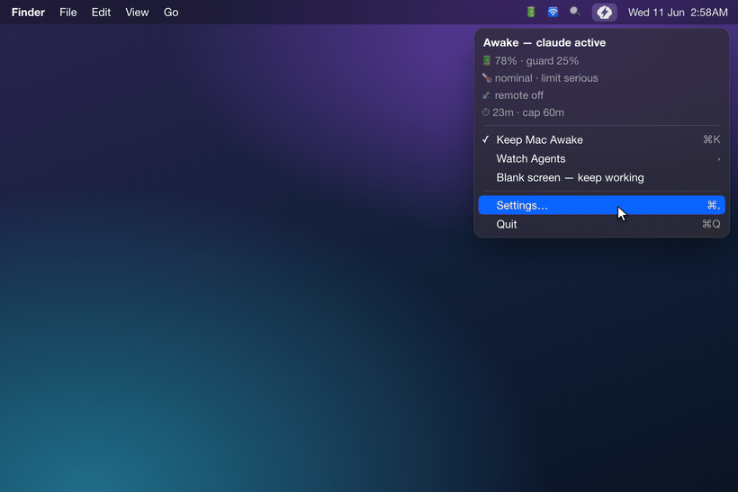
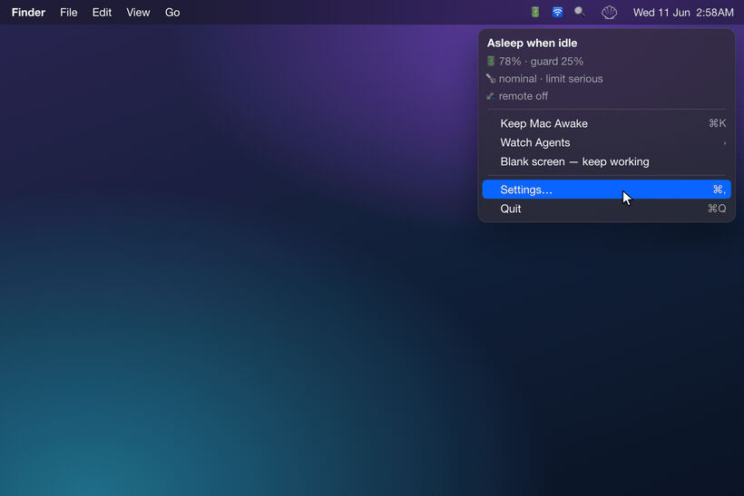
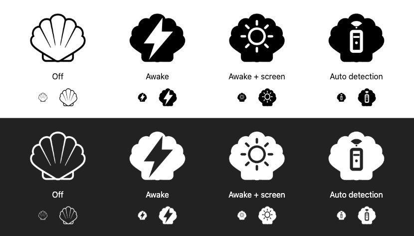

<div align="center">


# Electronic Clam

**Agents must keep working. Your Mac shouldn't cook trying.**
它感知的是*工作*,而不只是一个在运行的进程。

[](https://www.apple.com/macos/)
[](https://swift.org)
[](LICENSE)
[](CHANGELOG.md)

<!-- i18n-langbar -->
[English](README.md) · [한국어](README.ko.md) · **中文** · [日本語](README.ja.md) · [Español](README.es.md)

</div>

---

## v0.8.0 新功能: 在菜单栏选择屏幕常亮

- **点击循环切换：** 关闭 → Mac 保持唤醒 → Mac 与屏幕常亮 → 自动检测。新的**圆环太阳图标**让你无需打开菜单即可识别屏幕常亮模式。
- **默认启用：** 设置 → 通用 → **在图标循环中加入屏幕常亮模式**。关闭后恢复原来的开关操作和三种图标。升级时保留明确保存的关闭设置。
- **自行决定何时保持屏幕开启：** 启用设置只会添加模式，选择 **Mac 与屏幕常亮**才会启动。自动检测根据工作活动运行，不请求屏幕常亮。安全防护仍然优先。

[发行说明](https://github.com/jadhvank/eclam/releases/tag/v0.8.0) · [完整更新日志](CHANGELOG.md)

---

## 亮点

- **合盖也保持唤醒。** Mac 保持唤醒模式可让 Mac 合上盖子后也不睡眠, 无需终端命令,也不必每次切换都输入密码。
- **感知工作,而非进程。** 自动检测模式仅当编程代理*正在实际产出*时才保持唤醒;代理一停下,Mac 就能重新睡眠。
- **开箱即用支持 5 个代理**: Claude Code、Codex、Cursor、opencode、Antigravity, 还可以自行添加其他代理。
- **会随情况调整的安全防护。** 当电量或温度越过危险线时自动睡眠。
- **感知远程活动。** 自动检测模式识别 SSH、屏幕共享和 Tailscale 活动，在安全防护允许的范围内保持远程工作。
- **绝不读取你的对话或代码。** 代理检测只查看 transcript 的时间戳,从不读取其内容。

---

## 功能

目标是让你的代理**安全地**、不被打断地持续工作。下面的一切都为此服务。演示视频展示的是早期菜单，当前操作请参阅 [Usage](#usage)。

### 代理感知的保持唤醒


道理很简单:让你的代理不被打断地持续工作。

自动检测模式跟踪的是代理*此刻是否在工作*,而不是进程是否存在。工作期间 Mac 保持唤醒;一旦停下,保持就会释放(**Strict** 模式)。也提供只要进程存活就保持唤醒的 **Lax** 模式。

**默认检测(5 个):** Claude Code · Codex · Cursor · opencode · Antigravity。

**在 Customize 中启用(默认关闭):** Aider · Cline · Roo Code · OpenHands · Hermes · Openclaw。

未列出的代理也能添加, 提供一个 glob 模式,或在 `~/.config/eclam/traces.d/*.json` 中放入一个声明文件即可。

默认情况下,代理通过轮询其会话日志来检测(~5 秒,锁屏时 ~30 秒),所以刚启动的代理可能要过几秒才出现。Claude、Codex 和 Hermes 在安装(可选的)hook 后可被即时检测。

### 安全防护



在合盖(clamshell)模式下把 Mac 放进包里跑重负载,是有发热风险的。Electronic Clam 会盯着温度和电量,情况危险时就让 Mac 睡眠:

- **电量**: 阈值取决于你的配置:合盖且无外接显示器时为 30%,否则为 10%(可调)。微弱或不稳定的交流供电按电池计。
- **发热**: 把 macOS 的信号与一个更敏感的内部信号结合,以更快做出反应。
- **最长时长**: Desktop 模式(接电 + 开盖 + 外接显示器)会完全跳过上限。
- **低电量模式**: 把两个标准各收紧一档(电量 +10 个百分点,发热一档)。

当拔掉电源、合上盖子放进包里时,它会更谨慎地判断,情况恢复安全后自动解除。你也可以选择在它让 Mac 睡眠时收到通知。

### 远程活动感知



自动检测模式在安全防护允许的范围内，让远程使用中的 Mac 保持唤醒。它能检测 SSH、屏幕共享、Tailscale 以及已知的远程控制 App。默认很简单:只要你还连着就保持唤醒。

### 聊天通知: Telegram 和 Slack（默认关闭）

连接自己的 Telegram 机器人或 Slack 应用，当代理停止或 Mac 进入睡眠时，你会收到包含电量、温度和主机名的提醒。

两者均位于**设置 → 通知**，可分别开启或同时使用。消息仅发送到配置的服务；令牌由你创建和管理，保存在这台 Mac 的用户专用文件中。Slack 应用需要 `chat:write` 机器人权限（按名称查找频道还需 `channels:read`），安装到工作区后必须受邀加入目标频道。Slack 不支持静默发送，因此定期状态消息也会像普通消息一样到达；如需安静，请将频道静音。

### 其他

- **CLI + 命名会话**: 直接从终端操作(见 [Usage](#usage))。
- **可选的代理 hook**: 安装后会在 Claude / Codex / Hermes 的配置中注入一个活动信号 hook,卸载时还原。
- **退出时恢复睡眠**: 正常退出和 SIGTERM 会释放保持请求，20 秒 helper watchdog 提供崩溃恢复。
- **合盖 VPN 锁屏防护(可选)。** 在没有外接显示器的电池供电下,合上盖子通常会*锁屏*, 这会让 FortiClient SSL VPN 掉线(重连需要重新进行 SAML 登录)。一块隐形的虚拟显示器会锚定会话,于是屏幕不再锁定,隧道得以保留。**仅熄屏**动作也拆分为 **Dim**(变暗但对 VPN 安全,默认)和 **Sleep**,并可选地发送 VPN 断开通知。
- **稳健的 helper 设置**: 不会从被隔离(quarantine)的下载副本或临时(translocated)位置注册后台 helper(macOS 会在这些位置阻止它),而是引导你把 App 移到 Applications。设置 → 通用会标记重复副本和版本不一致,`eclam repair` / **Reinstall Helper** 可恢复卡住的注册。

## 安装

```bash
brew install --cask jadhvank/tap/eclam
open /Applications/ElectronicClam.app
```

在 **System Settings → General → Login Items & Extensions** 中开启 **Electronic Clam Helper**。

## Usage

**左键点击**依次切换**关闭 → Mac 保持唤醒 → Mac 与屏幕常亮 → 自动检测 → 关闭**。**右键点击**或 **Control-click** 打开完整菜单。应用启动时进入自动检测模式。

| 模式 | 图标 | 行为 |
|---|---|---|
| **关闭** | 贝壳轮廓 | 停止应用的唤醒请求，并抑制自动活动，直到你选择其他模式。 |
| **Mac 保持唤醒** | 实心贝壳 + 闪电 | 保持 Mac 唤醒，不请求屏幕常亮。 |
| **Mac 与屏幕常亮** | 实心贝壳 + 圆环太阳 | 保持 Mac 和屏幕开启。成功取得屏幕保持请求后才显示太阳。 |
| **自动检测** | 实心贝壳 + 遥控器 | 遵循代理和远程设置。等待活动时图标变淡。 |



设置 → 通用 → **在图标循环中加入屏幕常亮模式**默认开启。关闭后恢复按实际唤醒状态切换的开关操作及三种图标。若在 Mac 与屏幕常亮模式下关闭该设置，会切换至 Mac 保持唤醒并释放屏幕常亮请求。已保存的关闭设置会保留。

**屏幕常亮可能延迟自动锁定，并消耗屏幕电量。** 仍可手动锁定或使用 Dim。其他应用、锁定防护或 Dim 也可能保持屏幕开启；菜单的 **Display held by** 行显示实际屏幕保持请求。所有模式仍受安全防护限制，helper 故障提示优先于普通图标。

### 菜单

| 项目 | 动作 |
|---|---|
| 状态标题 | 一眼看清当前状态(例如 “空闲时睡眠”、“唤醒, 直到我退出”、“唤醒, 远程会话”) |
| **保持 Mac 唤醒**(⌘K) | 直接切换保持唤醒，仍为原有的开关快捷键 |
| **模式** ▸ | 直接选择四种模式之一；启用屏幕常亮模式设置时显示 |
| **监视代理** ▸ | 启用/停用要检测的代理(检测到活动时显示 “ • 活动中”);底部有 **自定义…** |
| **仅熄屏, 继续工作** | 默认将内置屏幕调暗而不锁定，也可让显示器睡眠，同时继续工作 |
| **设置…**(⌘,) | 打开设置 |
| **退出**(⌘Q) | 退出(退出前先恢复睡眠) |

### CLI

Homebrew cask 会创建一个 `$HOMEBREW_PREFIX/bin/eclam` 符号链接。

```
eclam on [--for <dur>] [--forever]   # keep awake; default 2h, then the helper auto-releases (no GUI needed, survives reboot)
eclam off
eclam status [--json]                 # also flags a quarantined/outside-Applications app, a failed helper, and duplicate copies
eclam repair                          # recover a wedged/unreachable helper (relaunches the app; guides you to sfltool resetbtm as a last resort)
eclam keep --while <pid>
eclam watch <agent> [--grace s] [--check-interval s] [--max min] [--json]
eclam session start <name> [--message <text>] / stop <name> / list [--json]
eclam debug [agents] [--json]
eclam help
```

**退出码:** `0` 成功 · `1` 参数错误 · `2` helper 不可达 · `3` 需要授权 · `4` 用户取消。

## 安全与隐私

- 读取文件时间，不读取文件内容。
- 无遥测、无追踪、无分析。
- Developer ID 发行版验证 XPC 调用方；ad-hoc 开发版本禁用该验证。
- Developer ID 签名 + Apple 公证。
- 令牌以用户专用权限保存在本地，仅发送到所配置的服务。
- 正常退出会释放电源保持请求，helper watchdog 提供崩溃恢复。
- 仅使用 `SMAppService` 权限路径。

详见[安全与隐私](docs/security.md)。

## 注意事项 / 已知限制

- **没有 hook 时检测可能延迟几秒。** 未安装 hook 的代理通过轮询其会话日志来检测(~5 秒,锁屏时 ~30 秒)。Claude / Codex / Hermes 在你安装其 hook 后即时生效。
- **仅用 CLI 时没有安全防护。**
- **请从 Applications 运行。** 若从 Downloads 或仍处于隔离(quarantine)状态的副本启动,macOS 不会让后台 helper 启动, 请把 Electronic Clam 移到 Applications 文件夹后重新打开。
- **嵌入 VS Code 的代理**(Cline / Roo Code)没有独立进程,因此 Lax 模式检测受限。
- **仅支持 Apple Silicon**,macOS 13+ (Ventura)。

## 技术栈

- **语言 / UI:** Swift + AppKit(`NSStatusItem`、`LSUIElement` 菜单栏 App, 无 Dock)。
- **电源控制:** IOKit SPI, 通过 `@_silgen_name` 绑定调用 `IOPMSetSystemPowerSetting("SleepDisabled")`。
- **权限分离:** 一个 `SMAppService` 守护进程,通过 `NSXPCConnection`(mach service)与 App 通信。
- **构建:** 直接 `swiftc`(无 SwiftPM),**无外部依赖**。
- **目标:** arm64,macOS 13+ (Ventura)。

## Build from source

```bash
./scripts/build.sh            # app + helper + hook binaries (Developer ID signed)
open build/ElectronicClam.app
```

- 直接调用 `swiftc`,目标 `arm64-apple-macos13.0`。快速的临时本地构建可设置 `ECLAM_SIGN_ID=-`。
- 包布局:`Contents/MacOS/{ElectronicClam, ElectronicClamHelper, eclam-hook}` + `Contents/Library/LaunchDaemons/com.jadhvank.eclam.helper.plist`。
- 发布版本经 Developer ID 签名并由 Apple 公证(由 `release.sh` staple)。

## 版本历史

近期版本, 完整历史见 [CHANGELOG.md](CHANGELOG.md):

- **0.8.0**: 四模式图标循环、圆环太阳屏幕常亮标识、默认开启模式入口并保留既有关闭设置，以及直接选择模式。[发行说明](https://github.com/jadhvank/eclam/releases/tag/v0.8.0)。
- **0.7.0**: 新增保持屏幕点亮选项、可恢复亮度的自动调暗和 Slack 通知，并改进本地安装及 Homebrew 卸载清理。VPN 监测本身不再阻止睡眠。[发行说明](https://github.com/jadhvank/eclam/releases/tag/v0.7.0)。
- **0.6.5**: 修复:启用合盖锁屏防护后,通过**屏幕镜像**连接电视现在可以正常工作。以镜像方式接入的显示器(镜像的电视、AirPlay)对防护是不可见的, macOS 会把镜像组的成员从活动显示器列表中剔除,并把整个镜像组报告为一块屏幕。于是在 macOS 协商镜像会话期间,隐形锚点会不断重新镜像、重新创建而横插一脚。扩展(并排)连接从来不受影响。此外,镜像组处于活动状态时不再创建锚点, 那种情况下会残留一块无法回收的虚拟显示器,并使防护在注销前彻底失效。
- **0.6.4**: 合盖 VPN 锁屏防护的修复:VPN 断开通知现在真的会触发(此前监视会被它本应报告的那个事件以及 App Nap 停掉),退出 App 时隐形锚点会一并释放,虚拟显示器的名称更清晰,并且在 **Dim** 之后重新打开上盖会恢复亮度。另外,当仅残留 quarantine 属性时,菜单栏不再反复给出「请移到 Applications」这一死胡同提示;散热截止的默认值也从 `fair` 提高到 `serious`(旧默认值可能在几分钟内就结束 keep-awake)。
- **0.6.3**: 修复:启用合盖锁屏防护后,接入真实外接显示器不再打乱你保存的「内置 + 外接」排列。真实显示器一出现,隐形锚点便立即让位(不再重新镜像),让 macOS 恢复你保存的布局;移除外接显示器后锚点会自动回归。合盖无头锁屏防护保持不变。
- **0.6.2**: 合盖 VPN 锁屏防护(可选):在没有外接显示器的电池供电下,合盖不再锁屏,于是 FortiClient SSL VPN 得以保留而非掉线, 一块隐形的虚拟显示器锚定会话。**仅熄屏**动作现在可选 **Dim**(对 VPN 安全,默认)或 **Sleep**,并可选开启 VPN 断开通知。
- **0.6.1**: 诚实的 helper 状态:已死却仍注册的 helper 不再错误显示为「已启用」。`eclam status` 会将其报告为 `unreachable`(退出码 2),App 在重新启动时自我修复,新增的 `eclam repair` 命令与菜单栏警告会加以呈现,`eclam status` 现在也会报告开机自启状态。
- **0.6.0**: 开机自启、应用内更新通知、唤醒历史、国际化(English · 한국어 · 中文 · 日本語 · Español)、单击切换、菜单栏图标主题、远程空闲策略、Telegram 状态通知、Developer ID 签名 + 公证。

更早:代理感知检测与 `watch` / `session` CLI(0.5.x)、状态条件下的电池 / 温度 / 定时安全防护(0.4.x)、远程活动感知与首个 CLI(0.3.x)。

## 赞助

Electronic Clam 是免费的开源软件。它让你的代理保持唤醒;你的咖啡让开发者保持清醒。☕

[](https://ko-fi.com/jadhvank)

## 许可证

[MIT](LICENSE)。

---

<sub>`README.zh-CN.md`、`README.ja.md` 和 `README.es.md` 由本文件通过 `/translate` 命令生成, 请勿手动编辑。`README.ko.md` 由人工维护。</sub>
